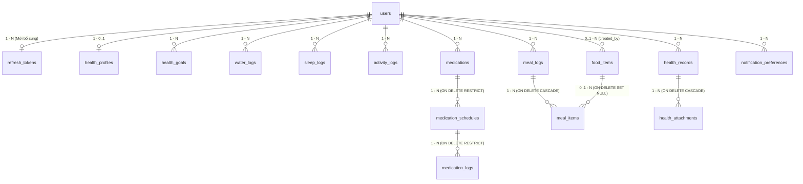

# BÁO CÁO REVIEW ERD & DATABASE SPECIFICATION – VITACARE

**Dự án:** VitaCare – Your Health, Your Life  
**Phiên bản đánh giá:** 1.0  
**Tài liệu đối chiếu:** `docs/SRS.md`, `docs/BUSINESS_RULES.md`, `docs/ERD.md`, `docs/DATABASE_SPECIFICATION.md`  
**Ngày thực hiện:** 17/11/2026  
**Người thực hiện:** Antigravity Architect / Senior Database Reviewer  

---

## 1. TỔNG QUAN THIẾT KẾ DATABASE

Hệ thống cơ sở dữ liệu của VitaCare được thiết kế cho ứng dụng theo dõi và quản lý sức khỏe cá nhân (Personal Health & Wellness) dựa trên nền tảng **PostgreSQL** kết hợp với **Prisma ORM**.

Thiết kế hiện tại gồm **15 bảng** phân chia theo 8 phân hệ nghiệp vụ chính:
1. **User & Auth:** `users`
2. **Profile & Goals:** `health_profiles`, `health_goals`
3. **Water Tracking:** `water_logs`
4. **Sleep Tracking:** `sleep_logs`
5. **Activity Tracking:** `activity_logs`
6. **Medication Management:** `medications`, `medication_schedules`, `medication_logs`
7. **Nutrition Tracking:** `food_items`, `meal_logs`, `meal_items`
8. **Health Records & Notifications:** `health_records`, `health_attachments`, `notification_preferences`

### Nhận định sơ bộ:
- Kiến trúc tổng thể phản ánh khá sát phạm vi MVP mô tả trong `SRS.md`.
- Sử dụng UUID làm Primary Key đồng nhất trên toàn bộ hệ thống.
- Sử dụng chuẩn `TIMESTAMPTZ` (UTC) theo đúng quy chuẩn `BR-SYS-01`.
- Đã có ý thức bảo toàn snapshot dinh dưỡng (`MEAL_ITEMS`) theo `BR-NUT-05` và phân biệt thực phẩm hệ thống / người dùng theo `BR-NUT-06`.
- **Tuy nhiên**, tài liệu ERD và Database Specification hiện tại còn tồn tại một số **lỗ hổng nghiêm trọng (Critical & High)** về: quản lý phiên đăng nhập/refresh token, thiếu index cho các foreign key quan trọng, lưu trữ tệp đính kèm chưa tối ưu cho signed URL, cơ chế chống trùng dữ liệu thiết bị chưa triệt để, thiếu trường trạng thái active của mục tiêu sức khỏe, và giới hạn trong cấu hình lịch nhắc thông báo.

---

## 2. DANH SÁCH CÁC BẢNG ĐÃ KIỂM TRA

Đã tiến hành rà soát chi tiết toàn diện 15 bảng theo SRS và Business Rules:

| STT | Tên bảng trong Spec | Tên thực thể ERD | Khóa chính | Khóa ngoại | Trạng thái rà soát |
|:---:|---|---|:---:|:---:|:---:|
| 1 | `users` | USERS | UUID | Không | Đã kiểm tra (Phát hiện thiếu sót) |
| 2 | `health_profiles` | HEALTH_PROFILES | UUID | `user_id` (1-1) | Đã kiểm tra (Hợp lý) |
| 3 | `health_goals` | HEALTH_GOALS | UUID | `user_id` (1-N) | Đã kiểm tra (Phát hiện thiếu sót) |
| 4 | `water_logs` | WATER_LOGS | UUID | `user_id` (1-N) | Đã kiểm tra (Hợp lý) |
| 5 | `sleep_logs` | SLEEP_LOGS | UUID | `user_id` (1-N) | Đã kiểm tra (Hợp lý) |
| 6 | `activity_logs` | ACTIVITY_LOGS | UUID | `user_id` (1-N) | Đã kiểm tra (Phát hiện thiếu sót) |
| 7 | `medications` | MEDICATIONS | UUID | `user_id` (1-N) | Đã kiểm tra (Hợp lý) |
| 8 | `medication_schedules` | MEDICATION_SCHEDULES | UUID | `medication_id` (1-N) | Đã kiểm tra (Phát hiện thiếu sót) |
| 9 | `medication_logs` | MEDICATION_LOGS | UUID | `schedule_id` (1-N) | Đã kiểm tra (Hợp lý) |
| 10 | `food_items` | FOOD_ITEMS | UUID | `created_by` (0..1-N) | Đã kiểm tra (Phát hiện thiếu sót) |
| 11 | `meal_logs` | MEAL_LOGS | UUID | `user_id` (1-N) | Đã kiểm tra (Hợp lý) |
| 12 | `meal_items` | MEAL_ITEMS | UUID | `meal_log_id`, `food_item_id` | Đã kiểm tra (Phát hiện thiếu sót) |
| 13 | `health_records` | HEALTH_RECORDS | UUID | `user_id` (1-N) | Đã kiểm tra (Phát hiện thiếu sót) |
| 14 | `health_attachments` | HEALTH_ATTACHMENTS | UUID | `health_record_id` (1-N) | Đã kiểm tra (Phát hiện thiếu sót) |
| 15 | `notification_preferences` | NOTIFICATION_PREFERENCES | UUID | `user_id` (1-N) | Đã kiểm tra (Phát hiện thiếu sót) |

---

## 3. CÁC ĐIỂM THIẾT KẾ HỢP LÝ

1. **Chuẩn hóa khóa chính UUID:** Toàn bộ bảng dùng UUID giúp tránh lộ số lượng bản ghi thực tế qua ID tự tăng (enumeration attack), hỗ trợ tốt môi trường phân tán và đồng bộ offline từ mobile sau này.
2. **Quy tắc bảo toàn lịch sử dinh dưỡng (BR-NUT-05):** `MEAL_ITEMS` lưu trữ các trường snapshot (`food_name_snapshot`, `calories_snapshot`, `protein_snapshot`, `carbs_snapshot`, `fat_snapshot`) và `food_item_id` cho phép NULL. Đây là thiết kế xuất sắc giúp nhật ký ăn uống trong quá khứ không bị sai lệch nếu bảng `FOOD_ITEMS` gốc bị thay đổi hoặc xóa.
3. **Phân biệt thực phẩm hệ thống và cá nhân (BR-NUT-06):** Cột `created_by` trong `FOOD_ITEMS` cho phép NULL (thực phẩm mặc định của hệ thống) hoặc trỏ tới `users.id` (thực phẩm do người dùng tự tạo).
4. **Phân tách lịch thuốc và lịch sử uống thuốc:** Thiết kế tách làm 3 tầng `MEDICATIONS` -> `MEDICATION_SCHEDULES` -> `MEDICATION_LOGS` giúp đáp ứng đầy đủ BR-MED-08 (sửa lịch không làm mất lịch sử đã uống) và hỗ trợ quản lý nhiều khung giờ/tần suất uống thuốc trong tuần.
5. **Hỗ trợ chỉ số huyết áp hai thành phần:** Bảng `HEALTH_RECORDS` có `value` và `secondary_value` linh hoạt, đáp ứng trường hợp đo huyết áp (tâm thu / tâm trương) mà không cần tạo bảng riêng biệt.
6. **Lưu trữ múi giờ người dùng:** Bảng `USERS` có trường `timezone`, hỗ trợ Backend tính toán mốc ngày theo giờ địa phương (`BR-SYS-03`, `BR-SYS-02`) trong khi dữ liệu thời gian thực vẫn lưu đồng nhất dưới dạng UTC `TIMESTAMPTZ` (`BR-SYS-01`).

---

## 4. CÁC LỖI VÀ THIẾU SÓT PHÁT HIỆN

### [CRITICAL] ISS-01: Thiếu bảng lưu trữ Refresh Token / User Session cho xác thực
- **Vị trí phát sinh:** `docs/ERD.md`, `docs/DATABASE_SPECIFICATION.md` (Nhóm User & Auth).
- **Nguyên nhân:** Tài liệu chỉ thiết kế bảng `users`, bỏ sót thực thể phiên làm việc hoặc refresh token.
- **Hậu quả vi phạm:**
  - Vi phạm yêu cầu kiến trúc SRS 2.1 ("Authentication: JWT + Refresh Token") và FR-AUTH-02, FR-AUTH-03 ("thu hồi hoặc vô hiệu hóa phiên làm mới tương ứng").
  - Nếu không lưu refresh token/session trong database, không thể thu hồi token khi người dùng đăng xuất, đổi mật khẩu hoặc xóa tài khoản.
- **Phương án xử lý:** Bổ sung bảng `refresh_tokens` liên kết 1-N với `users`, lưu token hash, user_id, device_info, expires_at, revoked_at.

---

### [HIGH] ISS-02: Cơ chế chống trùng lặp dữ liệu đồng bộ (HealthKit / Health Connect) chỉ dùng Index thường
- **Vị trí phát sinh:** `docs/DATABASE_SPECIFICATION.md` mục 2.6 (`ACTIVITY_LOGS`), bảng Index mục 4.
- **Nguyên nhân:** Spec ghi `INDEX(user_id, source, external_id)` nhưng lại đặt yêu cầu BR-ACT-05: *"Bản ghi đồng bộ cần có cơ chế chống trùng lặp"*. Index thông thường không ngăn chặn việc insert dữ liệu trùng.
- **Hậu quả vi phạm:** Khi ứng dụng mobile đồng bộ nhiều lần cùng một sự kiện từ Apple HealthKit hoặc Google Health Connect, các bản ghi có cùng `external_id` sẽ bị duplicate, làm sai lệch tổng số bước chân và thời lượng vận động trên Dashboard.
- **Phương án xử lý:** Thay thế bằng `UNIQUE INDEX activity_logs_user_source_external_idx ON activity_logs (user_id, source, external_id) WHERE external_id IS NOT NULL`.

---

### [HIGH] ISS-03: Thiếu Index trên các khóa ngoại (Foreign Keys) quan trọng gây suy giảm hiệu năng nghiêm trọng
- **Vị trí phát sinh:** `docs/DATABASE_SPECIFICATION.md` mục 4 (Indexes và hiệu năng).
- **Nguyên nhân:** PostgreSQL **không** tự động tạo index trên cột khóa ngoại. Trong danh sách index chỉ khai báo index cho các bảng cha theo thời gian, hoàn toàn thiếu index cho các quan hệ con:
  - `meal_items.meal_log_id`
  - `meal_items.food_item_id`
  - `medication_schedules.medication_id`
  - `health_attachments.health_record_id`
  - `food_items.created_by`
- **Hậu quả vi phạm:** Khi người dùng xem chi tiết bữa ăn hoặc mở hồ sơ sức khỏe có tệp đính kèm, PostgreSQL phải quét toàn bảng (`Seq Scan`) trên `meal_items` và `health_attachments`. Tệ hơn, khi xóa một `meal_logs` hoặc `health_records`, Postgres phải kiểm tra khóa ngoại bằng Seq Scan, gây khóa bảng và làm chậm hệ thống khi dữ liệu lớn dần.
- **Phương án xử lý:** Bổ sung explicit B-tree index cho tất cả các cột khóa ngoại tham chiếu.

---

### [HIGH] ISS-04: Lưu `file_url` tĩnh trong `HEALTH_ATTACHMENTS` không phù hợp với tệp riêng tư (Signed URL)
- **Vị trí phát sinh:** `docs/DATABASE_SPECIFICATION.md` mục 2.14 (`HEALTH_ATTACHMENTS`).
- **Nguyên nhân:** Bảng chỉ lưu `file_url TEXT`. Trong khi đó, tài liệu quy định rõ: *"Không lưu đường dẫn truy cập công khai nếu tệp chứa thông tin sức khỏe nhạy cảm. Ưu tiên signed URL có thời hạn"* (BR-HEALTH-05, SRS 4.2).
- **Hậu quả vi phạm:** Signed URL từ Cloud Storage (như Supabase Storage / S3) có thời hạn ngắn (ví dụ: 15–60 phút). Nếu lưu trực tiếp signed URL vào DB, link sẽ hết hạn và người dùng không thể xem lại tệp sau đó. Nếu lưu public URL thì vi phạm nghiêm trọng tính bảo mật dữ liệu y tế.
- **Phương án xử lý:**
  - Bổ sung trường `storage_path VARCHAR(500) NOT NULL` (ví dụ: `health-records/{userId}/{recordId}/{fileName}`).
  - `file_url` chỉ là trường runtime do backend sinh ra khi trả về cho client (hoặc client gọi API lấy signed URL thông qua `storage_path`).

---

### [HIGH] ISS-05: Thiếu trường xác định mục tiêu đang áp dụng trong `HEALTH_GOALS`
- **Vị trí phát sinh:** `docs/DATABASE_SPECIFICATION.md` mục 2.3 (`HEALTH_GOALS`).
- **Nguyên nhân:** Bảng có `start_date` và `end_date`, nhưng không có cờ `is_active` hoặc cơ chế xác định mục tiêu hiện tại cho mỗi `goal_type`.
- **Hậu quả vi phạm:**
  - Vi phạm quy tắc BR-DASH-04: *"Tiến độ mục tiêu được tính theo dữ liệu thực tế và mục tiêu đang áp dụng"*.
  - Nếu người dùng tạo nhiều mục tiêu cùng loại (`WATER`) mà `end_date` đều để NULL, câu truy vấn lấy mục tiêu hiện hành cho Dashboard sẽ trả về nhiều dòng, dẫn đến lỗi xử lý hoặc phải ORDER BY start_date DESC ngầm định thiếu chặt chẽ.
- **Phương án xử lý:** Bổ sung cột `is_active BOOLEAN DEFAULT TRUE NOT NULL` và constraint đảm bảo tại một thời điểm mỗi người dùng chỉ có tối đa 1 mục tiêu active cho mỗi loại: `UNIQUE(user_id, goal_type, is_active)` (áp dụng partial index cho `is_active = TRUE`).

---

### [HIGH] ISS-06: Trường `timezone` trong `USERS` là `NOT NULL` nhưng quy trình đăng ký không có trường này
- **Vị trí phát sinh:** `docs/DATABASE_SPECIFICATION.md` mục 2.1 đối chiếu với `docs/SRS.md` FR-AUTH-01.
- **Nguyên nhân:** SRS FR-AUTH-01 quy định thông tin đầu vào khi đăng ký chỉ gồm: *Email, Mật khẩu, Họ và tên, Xác nhận mật khẩu*. Không có trường `timezone`. Trong khi đó, bảng `users.timezone` lại định nghĩa `NOT NULL` và không có `DEFAULT`.
- **Hậu quả vi phạm:** API đăng ký sẽ báo lỗi `NotNullViolation` từ database nếu backend không tự gán giá trị mặc định khi người dùng đăng ký tài khoản mới.
- **Phương án xử lý:** Bổ sung giá trị mặc định cho cột: `DEFAULT 'Asia/Ho_Chi_Minh'` hoặc `DEFAULT 'UTC'`.

---

### [MEDIUM] ISS-07: Bảng `NOTIFICATION_PREFERENCES` chỉ có một giờ nhắc đơn lẻ (`reminder_time TIME`)
- **Vị trí phát sinh:** `docs/DATABASE_SPECIFICATION.md` mục 2.15.
- **Nguyên nhân:** Cột `reminder_time TIME NULL` chỉ lưu được 1 mốc giờ cố định.
- **Hậu quả vi phạm:**
  - Vi phạm yêu cầu FR-WATER-05 và SRS 3.3 ("Người dùng có thể bật/tắt nhắc nhở và thiết lập khung giờ phù hợp"). Nhắc uống nước thường diễn ra theo chu kỳ nhiều lần trong ngày (ví dụ: cách 2 tiếng từ 8:00 đến 20:00, hoặc mảng các giờ nhắc `['08:00', '10:00', '14:00', '16:00', '20:00']`).
  - Thiết kế hiện tại không thể đáp ứng nhắc nước theo khung giờ mà chỉ nhắc được đúng 1 lần/ngày.
- **Phương án xử lý:**
  - Mở rộng bảng: bổ sung `start_time TIME`, `end_time TIME`, `interval_minutes INTEGER`, hoặc lưu danh sách giờ dạng `TIME[]` / `JSONB`.

---

### [MEDIUM] ISS-08: Thiếu trường `updated_at` trong bảng `MEAL_ITEMS`
- **Vị trí phát sinh:** `docs/DATABASE_SPECIFICATION.md` mục 2.12.
- **Nguyên nhân:** Bảng `MEAL_ITEMS` chỉ có `created_at`, thiếu `updated_at`.
- **Hậu quả vi phạm:** Người dùng có quyền chỉnh sửa khẩu phần gram (`quantity_g`) của món ăn đã ghi nhận trong nhật ký bữa ăn. Khi cập nhật số gram, các giá trị snapshot calories/macronutrients được tính toán lại, nhưng không có dấu vết thời điểm chỉnh sửa.
- **Phương án xử lý:** Bổ sung `updated_at TIMESTAMPTZ NOT NULL DEFAULT NOW()`.

---

### [MEDIUM] ISS-09: Không đồng nhất tên cột ghi chú (`note` vs `notes`)
- **Vị trí phát sinh:**
  - `note` (số ít): `water_logs`, `sleep_logs`, `meal_logs`
  - `notes` (số nhiều): `medications`, `health_records`
- **Nguyên nhân:** Thiếu quy ước thống nhất trong quá trình soạn thảo tài liệu.
- **Hậu quả:** Gây nhầm lẫn cho lập trình viên Backend và Frontend khi gọi API, tăng nguy cơ mapping sai trường.
- **Phương án xử lý:** Chuẩn hóa toàn bộ thành `note` (số ít) trên tất cả các bảng.

---

### [MEDIUM] ISS-10: Thiếu hỗ trợ Soft Delete cho bảng `USERS`
- **Vị trí phát sinh:** `docs/DATABASE_SPECIFICATION.md` mục 2.1.
- **Nguyên nhân:** SRS FR-AUTH-04 và BR-AUTH-05 yêu cầu xử lý khi người dùng yêu cầu xóa tài khoản.
- **Hậu quả vi phạm:** Nếu thực hiện hard delete trực tiếp trên bảng `users`, hệ thống có nguy cơ mất toàn bộ dữ liệu lịch sử hoặc vi phạm ràng buộc toàn vẹn. Nếu người dùng muốn khôi phục tài khoản trong thời gian ân hạn (grace period 30 ngày) thì không thể thực hiện được.
- **Phương án xử lý:** Bổ sung trường `deleted_at TIMESTAMPTZ NULL` vào bảng `users`.

---

### [LOW] ISS-11: Thiếu trường `avatar_url` trong `HEALTH_PROFILES`
- **Vị trí phát sinh:** `docs/DATABASE_SPECIFICATION.md` mục 2.2.
- **Nguyên nhân:** Mặc dù SRS FR-PROFILE-01 không bắt buộc, nhưng ứng dụng di động có màn hình hiển thị hồ sơ cá nhân và Header Dashboard (hình đại diện người dùng).
- **Hậu quả:** Không có nơi lưu ảnh đại diện người dùng nếu cần hiển thị trên app.
- **Phương án xử lý:** Bổ sung trường `avatar_url VARCHAR(500) NULL` vào `health_profiles`.

---

## 5. NHỮNG QUAN HỆ CẦN ĐIỀU CHỈNH



### Các điều chỉnh chi tiết về quan hệ:
1. **Bổ sung quan hệ `users` (1) — (N) `refresh_tokens`:** Quản lý vòng đời phiên đăng nhập.
2. **Quy tắc xóa `medications` -> `medication_schedules` -> `medication_logs`:**
   - Phải thiết lập `ON DELETE RESTRICT` (hoặc `NO ACTION`).
   - Tuyệt đối **không** dùng `CASCADE DELETE`. Khi người dùng ngừng dùng thuốc, backend cập nhật `is_active = FALSE` trên `medications` để bảo toàn lịch sử uống thuốc (`BR-MED-08`).
3. **Quy tắc xóa `food_items` -> `meal_items`:**
   - Phải thiết lập `ON DELETE SET NULL`.
   - Khi một món ăn do người dùng tạo bị xóa, các dòng trong `meal_items` vẫn được giữ nguyên, `food_item_id` chuyển về `NULL`, dữ liệu snapshot vẫn toàn vẹn (`BR-NUT-05`).
4. **Quy tắc xóa `meal_logs` -> `meal_items` và `health_records` -> `health_attachments`:**
   - Cho phép `ON DELETE CASCADE`. Khi người dùng chủ động xóa một bữa ăn hoặc một hồ sơ khám bệnh, các chi tiết con đi kèm được xóa đồng bộ.

---

## 6. NHỮNG TRƯỜNG DỮ LIỆU CẦN BỔ SUNG HOẶC THAY ĐỔI

| Bảng | Tên trường | Kiểu dữ liệu | Ràng buộc | Lý do điều chỉnh |
|---|---|---|---|---|
| **users** | `timezone` | VARCHAR(100) | `NOT NULL DEFAULT 'Asia/Ho_Chi_Minh'` | Tránh lỗi insert khi đăng ký tài khoản mới (ISS-06) |
| **users** | `deleted_at` | TIMESTAMPTZ | `NULL` | Hỗ trợ soft delete tài khoản theo BR-AUTH-05 (ISS-10) |
| **refresh_tokens** *(Mới)* | Toàn bộ bảng | Bảng mới | Bảng xác thực | Quản lý JWT Refresh token, logout và token rotation (ISS-01) |
| **health_profiles** | `avatar_url` | VARCHAR(500) | `NULL` | Lưu trữ ảnh đại diện người dùng (ISS-11) |
| **health_goals** | `is_active` | BOOLEAN | `NOT NULL DEFAULT TRUE` | Xác định mục tiêu đang hiệu lực cho Dashboard (ISS-05) |
| **activity_logs** | `(user_id, source, external_id)` | UNIQUE INDEX | Partial `WHERE external_id IS NOT NULL` | Chống duplicate sync từ HealthKit/Health Connect (ISS-02) |
| **medications** | `notes` -> `note` | TEXT | `NULL` | Đồng nhất tên cột với các bảng khác (ISS-09) |
| **meal_items** | `updated_at` | TIMESTAMPTZ | `NOT NULL DEFAULT NOW()` | Ghi nhận thời gian cập nhật khẩu phần (ISS-08) |
| **health_records** | `notes` -> `note` | TEXT | `NULL` | Đồng nhất tên cột (ISS-09) |
| **health_attachments** | `storage_path` | VARCHAR(500) | `NOT NULL` | Lưu đường dẫn tệp trên Cloud Storage để tạo signed URL (ISS-04) |
| **notification_preferences** | `reminder_times` | TEXT[] hoặc JSONB | `NULL` | Cho phép cấu hình nhiều mốc giờ nhắc nước trong ngày (ISS-07) |

---

## 7. CÁC VẤN ĐỀ BẢO MẬT (SECURITY REVIEW)

1. **Kiểm tra quyền sở hữu dữ liệu (Multi-tenancy Data Isolation):**
   - **Thực trạng:** 11/15 bảng có trực tiếp cột `user_id`. Riêng 4 bảng con (`medication_schedules`, `medication_logs`, `meal_items`, `health_attachments`) liên kết thông qua bảng cha.
   - **Đánh giá rủi ro:** Lập trình viên Backend có nguy cơ thực hiện câu truy vấn `UPDATE` hoặc `DELETE` trên bảng con mà quên kiểm tra quyền sở hữu của user trên bảng cha (IDOR - Insecure Direct Object Reference).
   - **Giải pháp bắt buộc:** Tại tầng Backend NestJS, mọi thao tác trên `medication_schedules`, `medication_logs`, `meal_items`, `health_attachments` phải luôn join hoặc verify quan hệ sở hữu với `users.id` lấy từ JWT access token.
2. **Bảo vệ mật khẩu:**
   - Cột `password_hash VARCHAR(255)` hoàn toàn phù hợp để lưu trữ chuỗi băm an toàn từ thuật toán **Argon2id** (hoặc bcrypt) theo đúng quy định SRS 4.2 và BR-AUTH-04.
   - Phải cấu hình Prisma exclude `password_hash` khỏi các câu query mặc định để tránh vô tình trả về qua API.
3. **Bảo vệ tệp đính kèm hồ sơ sức khỏe (`health_attachments`):**
   - Không được cấu hình Bucket trên Supabase Storage/AWS S3 ở chế độ Public.
   - Bucket phải là Private. Backend có nhiệm vụ kiểm tra quyền sở hữu của user trước khi ký một presigned URL (thời hạn 15–30 phút) trả về cho Mobile app.
4. **Bảo vệ Refresh Token:**
   - Nên băm giá trị refresh token trước khi lưu vào bảng `refresh_tokens` trong database để phòng ngừa trường hợp database bị lộ thì attacker vẫn không thể dùng token đó để refresh.

---

## 8. CÁC VẤN ĐỀ HIỆU NĂNG (PERFORMANCE REVIEW)

1. **Hiệu năng Dashboard (FR-DASH-01):**
   - Dashboard yêu cầu truy vấn đồng thời dữ liệu trong ngày của: nước uống, giấc ngủ, hoạt động, dinh dưỡng, lịch thuốc.
   - Đã có composite index `(user_id, consumed_at DESC)` trên `water_logs`, `(user_id, sleep_start DESC)` trên `sleep_logs`, `(user_id, recorded_at DESC)` trên `activity_logs`, `(user_id, consumed_at DESC)` trên `meal_logs`. Các index này hỗ trợ tối ưu việc lọc theo khoảng thời gian ngày hiện tại.
2. **Tìm kiếm danh mục thực phẩm (`FOOD_ITEMS`):**
   - Người dùng thường xuyên tìm kiếm món ăn theo tên khi thêm bữa ăn (FR-NUT-02).
   - Hiện tại bảng `food_items` **chưa có bất kỳ index nào trên cột `name`**. Khi danh mục thực phẩm lên tới hàng chục nghìn món, câu lệnh `WHERE name ILIKE '%pho%'` sẽ quét toàn bảng rất chậm.
   - **Đề xuất:** Cần tạo chỉ mục `GIN` với extension `pg_trgm` trên PostgreSQL:
     ```sql
     CREATE EXTENSION IF NOT EXISTS pg_trgm;
     CREATE INDEX food_items_name_trgm_idx ON food_items USING gin (name gin_trgm_ops);
     ```
3. **Truy vấn danh sách thuốc hôm nay (Daily Medication Schedule):**
   - Để lấy các thuốc cần uống hôm nay, hệ thống phải join `medications` -> `medication_schedules`.
   - Cần bổ sung index:
     - `medications(user_id, is_active)` (đã có trong spec).
     - `medication_schedules(medication_id, is_enabled)` (cần bổ sung).

---

## 9. ĐỀ XUẤT PRISMA SCHEMA HOÀN CHỈNH

Dưới đây là bản thiết kế `schema.prisma` chuẩn hóa, khắc phục toàn bộ các thiếu sót đã nêu:

```prisma
// ============================================================
// VITACARE PRISMA SCHEMA (OPTIMIZED VERSION 1.1)
// Platform: NestJS + Prisma ORM + PostgreSQL
// ============================================================

generator client {
  provider = "prisma-client-js"
}

datasource db {
  provider = "postgresql"
  url      = env("DATABASE_URL")
}

// ------------------------------------------------------------
// ENUMS
// ------------------------------------------------------------

enum Gender {
  MALE
  FEMALE
  OTHER
  PREFER_NOT_TO_SAY
}

enum SleepQuality {
  VERY_POOR
  POOR
  NORMAL
  GOOD
  EXCELLENT
}

enum ActivityType {
  WALKING
  RUNNING
  CYCLING
  GYM
  OTHER
}

enum DataSource {
  MANUAL
  HEALTHKIT
  HEALTH_CONNECT
}

enum MedicationFrequency {
  DAILY
  WEEKLY
  INTERVAL
  CUSTOM
}

enum MedicationLogStatus {
  PENDING
  TAKEN
  SKIPPED
}

enum MealType {
  BREAKFAST
  LUNCH
  DINNER
  SNACK
}

enum HealthRecordType {
  WEIGHT
  HEIGHT
  BLOOD_PRESSURE
  HEART_RATE
  BLOOD_GLUCOSE
  OTHER
}

enum GoalType {
  WATER
  SLEEP
  STEPS
  ACTIVITY_DURATION
  CALORIES
}

enum NotificationType {
  WATER
  SLEEP
  MEDICATION
  ACTIVITY
}

// ------------------------------------------------------------
// 1. USERS & AUTH
// ------------------------------------------------------------

model User {
  id           String    @id @default(uuid()) @db.Uuid
  email        String    @unique @db.VarChar(255)
  passwordHash String    @map("password_hash") @db.VarChar(255)
  fullName     String    @map("full_name") @db.VarChar(150)
  timezone     String    @default("Asia/Ho_Chi_Minh") @db.VarChar(100)
  isActive     Boolean   @default(true) @map("is_active")
  createdAt    DateTime  @default(now()) @map("created_at") @db.Timestamptz
  updatedAt    DateTime  @updatedAt @map("updated_at") @db.Timestamptz
  deletedAt    DateTime? @map("deleted_at") @db.Timestamptz

  // Quan hệ
  refreshTokens     RefreshToken[]
  healthProfile     HealthProfile?
  healthGoals       HealthGoal[]
  waterLogs         WaterLog[]
  sleepLogs         SleepLog[]
  activityLogs      ActivityLog[]
  medications       Medication[]
  createdFoodItems  FoodItem[]               @relation("UserCreatedFoods")
  mealLogs          MealLog[]
  healthRecords     HealthRecord[]
  notificationPrefs NotificationPreference[]

  @@index([isActive])
  @@map("users")
}

model RefreshToken {
  id         String    @id @default(uuid()) @db.Uuid
  userId     String    @map("user_id") @db.Uuid
  tokenHash  String    @unique @map("token_hash") @db.VarChar(255)
  deviceInfo String?   @map("device_info") @db.VarChar(255)
  expiresAt  DateTime  @map("expires_at") @db.Timestamptz
  revokedAt  DateTime? @map("revoked_at") @db.Timestamptz
  createdAt  DateTime  @default(now()) @map("created_at") @db.Timestamptz

  user User @relation(fields: [userId], references: [id], onDelete: Cascade)

  @@index([userId])
  @@map("refresh_tokens")
}

// ------------------------------------------------------------
// 2. HEALTH PROFILES & GOALS
// ------------------------------------------------------------

model HealthProfile {
  id          String    @id @default(uuid()) @db.Uuid
  userId      String    @unique @map("user_id") @db.Uuid
  dateOfBirth DateTime? @map("date_of_birth") @db.Date
  heightCm    Decimal?  @map("height_cm") @db.Decimal(5, 2)
  weightKg    Decimal?  @map("weight_kg") @db.Decimal(5, 2)
  gender      Gender?
  avatarUrl   String?   @map("avatar_url") @db.VarChar(500)
  createdAt   DateTime  @default(now()) @map("created_at") @db.Timestamptz
  updatedAt   DateTime  @updatedAt @map("updated_at") @db.Timestamptz

  user User @relation(fields: [userId], references: [id], onDelete: Cascade)

  @@map("health_profiles")
}

model HealthGoal {
  id          String    @id @default(uuid()) @db.Uuid
  userId      String    @map("user_id") @db.Uuid
  goalType    GoalType  @map("goal_type")
  targetValue Decimal   @map("target_value") @db.Decimal(10, 2)
  unit        String    @db.VarChar(30)
  startDate   DateTime  @map("start_date") @db.Date
  endDate     DateTime? @map("end_date") @db.Date
  isActive    Boolean   @default(true) @map("is_active")
  createdAt   DateTime  @default(now()) @map("created_at") @db.Timestamptz
  updatedAt   DateTime  @updatedAt @map("updated_at") @db.Timestamptz

  user User @relation(fields: [userId], references: [id], onDelete: Cascade)

  @@index([userId, goalType, startDate(sort: Desc)])
  @@index([userId, isActive])
  @@map("health_goals")
}

// ------------------------------------------------------------
// 3. WATER TRACKING
// ------------------------------------------------------------

model WaterLog {
  id          String   @id @default(uuid()) @db.Uuid
  userId      String   @map("user_id") @db.Uuid
  amountMl    Int      @map("amount_ml")
  consumedAt  DateTime @map("consumed_at") @db.Timestamptz
  note        String?  @db.Text
  createdAt   DateTime @default(now()) @map("created_at") @db.Timestamptz
  updatedAt   DateTime @updatedAt @map("updated_at") @db.Timestamptz

  user User @relation(fields: [userId], references: [id], onDelete: Cascade)

  @@index([userId, consumedAt(sort: Desc)])
  @@map("water_logs")
}

// ------------------------------------------------------------
// 4. SLEEP TRACKING
// ------------------------------------------------------------

model SleepLog {
  id              String        @id @default(uuid()) @db.Uuid
  userId          String        @map("user_id") @db.Uuid
  sleepStart      DateTime      @map("sleep_start") @db.Timestamptz
  sleepEnd        DateTime      @map("sleep_end") @db.Timestamptz
  durationMinutes Int           @map("duration_minutes")
  quality         SleepQuality?
  note            String?       @db.Text
  createdAt       DateTime      @default(now()) @map("created_at") @db.Timestamptz
  updatedAt       DateTime      @updatedAt @map("updated_at") @db.Timestamptz

  user User @relation(fields: [userId], references: [id], onDelete: Cascade)

  @@index([userId, sleepStart(sort: Desc)])
  @@map("sleep_logs")
}

// ------------------------------------------------------------
// 5. ACTIVITY TRACKING
// ------------------------------------------------------------

model ActivityLog {
  id              String       @id @default(uuid()) @db.Uuid
  userId          String       @map("user_id") @db.Uuid
  activityType    ActivityType @map("activity_type")
  steps           Int?
  durationMinutes Int?         @map("duration_minutes")
  source          DataSource   @default(MANUAL)
  externalId      String?      @map("external_id") @db.VarChar(255)
  recordedAt      DateTime     @map("recorded_at") @db.Timestamptz
  createdAt       DateTime     @default(now()) @map("created_at") @db.Timestamptz
  updatedAt       DateTime     @updatedAt @map("updated_at") @db.Timestamptz

  user User @relation(fields: [userId], references: [id], onDelete: Cascade)

  @@index([userId, recordedAt(sort: Desc)])
  @@index([userId, source, externalId])
  @@map("activity_logs")
}

// ------------------------------------------------------------
// 6. MEDICATION MANAGEMENT
// ------------------------------------------------------------

model Medication {
  id          String   @id @default(uuid()) @db.Uuid
  userId      String   @map("user_id") @db.Uuid
  name        String   @db.VarChar(255)
  dosageLabel String?  @map("dosage_label") @db.VarChar(255)
  note        String?  @db.Text
  isActive    Boolean  @default(true) @map("is_active")
  createdAt   DateTime @default(now()) @map("created_at") @db.Timestamptz
  updatedAt   DateTime @updatedAt @map("updated_at") @db.Timestamptz

  user      User                 @relation(fields: [userId], references: [id], onDelete: Cascade)
  schedules MedicationSchedule[]

  @@index([userId, isActive])
  @@map("medications")
}

model MedicationSchedule {
  id           String              @id @default(uuid()) @db.Uuid
  medicationId String              @map("medication_id") @db.Uuid
  frequency    MedicationFrequency
  reminderTime DateTime            @map("reminder_time") @db.Time
  weekdays     Int[]
  intervalDays Int?                @map("interval_days")
  startDate    DateTime            @map("start_date") @db.Date
  endDate      DateTime?           @map("end_date") @db.Date
  isEnabled    Boolean             @default(true) @map("is_enabled")
  createdAt    DateTime            @default(now()) @map("created_at") @db.Timestamptz
  updatedAt    DateTime            @updatedAt @map("updated_at") @db.Timestamptz

  medication Medication      @relation(fields: [medicationId], references: [id], onDelete: Restrict)
  logs       MedicationLog[]

  @@index([medicationId, isEnabled])
  @@map("medication_schedules")
}

model MedicationLog {
  id          String              @id @default(uuid()) @db.Uuid
  scheduleId  String              @map("schedule_id") @db.Uuid
  scheduledAt DateTime            @map("scheduled_at") @db.Timestamptz
  takenAt     DateTime?           @map("taken_at") @db.Timestamptz
  status      MedicationLogStatus @default(PENDING)
  note        String?             @db.Text
  createdAt   DateTime            @default(now()) @map("created_at") @db.Timestamptz
  updatedAt   DateTime            @updatedAt @map("updated_at") @db.Timestamptz

  schedule MedicationSchedule @relation(fields: [scheduleId], references: [id], onDelete: Restrict)

  @@unique([scheduleId, scheduledAt])
  @@index([scheduleId])
  @@map("medication_logs")
}

// ------------------------------------------------------------
// 7. NUTRITION TRACKING
// ------------------------------------------------------------

model FoodItem {
  id               String   @id @default(uuid()) @db.Uuid
  createdBy        String?  @map("created_by") @db.Uuid
  name             String   @db.VarChar(255)
  caloriesPer100g  Decimal? @map("calories_per_100g") @db.Decimal(10, 2)
  proteinPer100g   Decimal? @map("protein_per_100g") @db.Decimal(10, 2)
  carbsPer100g     Decimal? @map("carbs_per_100g") @db.Decimal(10, 2)
  fatPer100g       Decimal? @map("fat_per_100g") @db.Decimal(10, 2)
  source           String?  @db.VarChar(100)
  isActive         Boolean  @default(true) @map("is_active")
  createdAt        DateTime @default(now()) @map("created_at") @db.Timestamptz
  updatedAt        DateTime @updatedAt @map("updated_at") @db.Timestamptz

  creator   User?      @relation("UserCreatedFoods", fields: [createdBy], references: [id], onDelete: SetNull)
  mealItems MealItem[]

  @@index([createdBy])
  @@index([name])
  @@map("food_items")
}

model MealLog {
  id         String   @id @default(uuid()) @db.Uuid
  userId     String   @map("user_id") @db.Uuid
  mealType   MealType @map("meal_type")
  consumedAt DateTime @map("consumed_at") @db.Timestamptz
  note       String?  @db.Text
  createdAt  DateTime @default(now()) @map("created_at") @db.Timestamptz
  updatedAt  DateTime @updatedAt @map("updated_at") @db.Timestamptz

  user      User       @relation(fields: [userId], references: [id], onDelete: Cascade)
  mealItems MealItem[]

  @@index([userId, consumedAt(sort: Desc)])
  @@map("meal_logs")
}

model MealItem {
  id               String   @id @default(uuid()) @db.Uuid
  mealLogId        String   @map("meal_log_id") @db.Uuid
  foodItemId       String?  @map("food_item_id") @db.Uuid
  foodNameSnapshot String   @map("food_name_snapshot") @db.VarChar(255)
  quantityG        Decimal  @map("quantity_g") @db.Decimal(10, 2)
  caloriesSnapshot Decimal? @map("calories_snapshot") @db.Decimal(10, 2)
  proteinSnapshot  Decimal? @map("protein_snapshot") @db.Decimal(10, 2)
  carbsSnapshot    Decimal? @map("carbs_snapshot") @db.Decimal(10, 2)
  fatSnapshot      Decimal? @map("fat_snapshot") @db.Decimal(10, 2)
  createdAt        DateTime @default(now()) @map("created_at") @db.Timestamptz
  updatedAt        DateTime @updatedAt @map("updated_at") @db.Timestamptz

  mealLog  MealLog   @relation(fields: [mealLogId], references: [id], onDelete: Cascade)
  foodItem FoodItem? @relation(fields: [foodItemId], references: [id], onDelete: SetNull)

  @@index([mealLogId])
  @@index([foodItemId])
  @@map("meal_items")
}

// ------------------------------------------------------------
// 8. HEALTH RECORDS & ATTACHMENTS
// ------------------------------------------------------------

model HealthRecord {
  id             String           @id @default(uuid()) @db.Uuid
  userId         String           @map("user_id") @db.Uuid
  recordType     HealthRecordType @map("record_type")
  value          Decimal          @db.Decimal(12, 2)
  secondaryValue Decimal?         @map("secondary_value") @db.Decimal(12, 2)
  unit           String           @db.VarChar(30)
  source         DataSource       @default(MANUAL)
  recordedAt     DateTime         @map("recorded_at") @db.Timestamptz
  note           String?          @db.Text
  createdAt      DateTime         @default(now()) @map("created_at") @db.Timestamptz
  updatedAt      DateTime         @updatedAt @map("updated_at") @db.Timestamptz

  user        User               @relation(fields: [userId], references: [id], onDelete: Cascade)
  attachments HealthAttachment[]

  @@index([userId, recordType, recordedAt(sort: Desc)])
  @@map("health_records")
}

model HealthAttachment {
  id             String   @id @default(uuid()) @db.Uuid
  healthRecordId String   @map("health_record_id") @db.Uuid
  storagePath    String   @map("storage_path") @db.VarChar(500)
  fileName       String   @map("file_name") @db.VarChar(255)
  fileType       String   @map("file_type") @db.VarChar(100)
  fileSize       BigInt?  @map("file_size")
  createdAt      DateTime @default(now()) @map("created_at") @db.Timestamptz

  healthRecord HealthRecord @relation(fields: [healthRecordId], references: [id], onDelete: Cascade)

  @@index([healthRecordId])
  @@map("health_attachments")
}

// ------------------------------------------------------------
// 9. NOTIFICATION PREFERENCES
// ------------------------------------------------------------

model NotificationPreference {
  id               String           @id @default(uuid()) @db.Uuid
  userId           String           @map("user_id") @db.Uuid
  notificationType NotificationType @map("notification_type")
  enabled          Boolean          @default(true)
  reminderTime     DateTime?        @map("reminder_time") @db.Time
  reminderTimes    String[]         @default([]) @map("reminder_times")
  createdAt        DateTime         @default(now()) @map("created_at") @db.Timestamptz
  updatedAt        DateTime         @updatedAt @map("updated_at") @db.Timestamptz

  user User @relation(fields: [userId], references: [id], onDelete: Cascade)

  @@unique([userId, notificationType])
  @@index([userId])
  @@map("notification_preferences")
}
```

### Các ràng buộc cần bổ sung bằng Custom SQL Migration:
Vì Prisma Schema không hỗ trợ khai báo cú pháp `CHECK` constraint và `Partial Index`, các ràng buộc sau đây phải được tạo trong file migration SQL đầu tiên (`prisma/migrations/0_init/migration.sql`):

```sql
-- 1. Chống trùng lặp dữ liệu sync từ thiết bị ngoài
CREATE UNIQUE INDEX IF NOT EXISTS activity_logs_user_source_ext_uniq 
ON activity_logs (user_id, source, external_id) 
WHERE external_id IS NOT NULL;

-- 2. Giới hạn mỗi người dùng chỉ có 1 mục tiêu active cho mỗi loại tại một thời điểm
CREATE UNIQUE INDEX IF NOT EXISTS health_goals_user_type_active_uniq 
ON health_goals (user_id, goal_type) 
WHERE is_active = TRUE;

-- 3. Check constraints cho các giá trị sinh học và logic thời gian
ALTER TABLE water_logs 
  ADD CONSTRAINT chk_water_amount_positive CHECK (amount_ml > 0);

ALTER TABLE sleep_logs 
  ADD CONSTRAINT chk_sleep_time_logic CHECK (sleep_end > sleep_start),
  ADD CONSTRAINT chk_sleep_duration_positive CHECK (duration_minutes > 0);

ALTER TABLE activity_logs 
  ADD CONSTRAINT chk_activity_steps_positive CHECK (steps IS NULL OR steps >= 0),
  ADD CONSTRAINT chk_activity_duration_positive CHECK (duration_minutes IS NULL OR duration_minutes > 0);

ALTER TABLE health_profiles 
  ADD CONSTRAINT chk_profile_height_positive CHECK (height_cm IS NULL OR height_cm > 0),
  ADD CONSTRAINT chk_profile_weight_positive CHECK (weight_kg IS NULL OR weight_kg > 0);

ALTER TABLE health_goals 
  ADD CONSTRAINT chk_goal_target_positive CHECK (target_value > 0),
  ADD CONSTRAINT chk_goal_date_logic CHECK (end_date IS NULL OR end_date >= start_date);

ALTER TABLE meal_items 
  ADD CONSTRAINT chk_meal_quantity_positive CHECK (quantity_g > 0),
  ADD CONSTRAINT chk_meal_calories_positive CHECK (calories_snapshot IS NULL OR calories_snapshot >= 0);

-- 4. Tìm kiếm món ăn bằng pg_trgm
CREATE EXTENSION IF NOT EXISTS pg_trgm;
CREATE INDEX IF NOT EXISTS food_items_name_trgm_idx ON food_items USING gin (name gin_trgm_ops);
```

---

## 10. KẾT LUẬN VÀ DANH SÁCH VIỆC CẦN HOÀN THIỆN

### 10.1. Kết luận mức độ sẵn sàng
> **KẾT LUẬN: THIẾT KẾ DATABASE HIỆN TẠI CHƯA SẴN SÀNG ĐỂ TRIỂN KHAI TRỰC TIẾP.**  
> Nếu triển khai ngay theo bản spec cũ sẽ lập tức gặp lỗi ở luồng Xác thực (thiếu Refresh Token), lỗi Registration (do timezone NOT NULL), nguy cơ duplicate bản ghi đồng bộ từ HealthKit, và lỗi link tệp y tế bị die sau vài chục phút.  
> Tuy nhiên, **sau khi cập nhật theo các đề xuất tại mục 6 và áp dụng Prisma Schema tại mục 9, hệ thống sẽ hoàn toàn đạt chuẩn Enterprise, sẵn sàng để lập trình.**

### 10.2. Thống kê số lượng vấn đề phát hiện

| Mức độ nghiêm trọng | Số lượng | Vấn đề tiêu biểu |
|:---:|:---:|---|
| **Critical** | **1** | ISS-01: Thiếu bảng lưu trữ Refresh Token / User Session |
| **High** | **5** | ISS-02 (Trùng sync data), ISS-03 (Thiếu index FK), ISS-04 (Signed URL tệp đính kèm), ISS-05 (Mục tiêu active), ISS-06 (Timezone default) |
| **Medium** | **4** | ISS-07 (Khung giờ nhắc nước), ISS-08 (`updated_at` meal_items), ISS-09 (Lệch note/notes), ISS-10 (Soft delete user) |
| **Low** | **1** | ISS-11 (avatar_url trong profile) |
| **TỔNG CỘNG** | **11** | **Đã có giải pháp xử lý triệt để** |

### 10.3. Danh sách các quyết định cần người dùng xác nhận

1. **Xác nhận thêm bảng `refresh_tokens`:** Xác nhận việc bổ sung bảng này để lưu trữ phiên làm việc của JWT và hỗ trợ tính năng đăng xuất / token rotation (FR-AUTH-03).
2. **Xác nhận thay đổi trường `file_url` -> `storage_path` trong `health_attachments`:** Tệp hồ sơ bệnh án nhạy cảm sẽ được bảo vệ trong Private bucket và chỉ sinh presigned URL khi người dùng yêu cầu xem.
3. **Xác nhận cơ chế nhắc nước đa khung giờ trong `notification_preferences`:** Cho phép lưu nhiều mốc giờ (`reminder_times String[]`) thay vì chỉ 1 giờ cố định để đáp ứng tính năng nhắc uống nước trong ngày.
4. **Xác nhận cập nhật tài liệu `docs/ERD.md` và `docs/DATABASE_SPECIFICATION.md`:** Đồng ý áp dụng các chỉnh sửa này vào 2 file tài liệu đặc tả trước khi chuyển sang giai đoạn tạo Prisma migration và code Backend.

