# VITACARE – ENTITY RELATIONSHIP DIAGRAM (ERD)

**Version:** 1.1  
**Ngày cập nhật:** 17/11/2026  
**Database Engine:** PostgreSQL 16+  
**ORM:** Prisma ORM  
**Primary Key:** UUID v4  
**Timestamp Standard:** UTC (TIMESTAMPTZ)  

---

## 1. Tổng quan kiến trúc dữ liệu

Database VitaCare phục vụ ứng dụng quản lý sức khỏe cá nhân (Personal Health & Wellness), bao gồm **16 bảng** được phân nhóm logic như sau:

1. **User & Auth:** `users`, `refresh_tokens` – Tài khoản, phân quyền và quản lý phiên JWT.
2. **Profile & Goals:** `health_profiles`, `health_goals` – Hồ sơ thể chất và mục tiêu sức khỏe.
3. **Water Tracking:** `water_logs` – Lịch sử ghi nhận lượng nước uống.
4. **Sleep Tracking:** `sleep_logs` – Lịch sử theo dõi giấc ngủ.
5. **Activity Tracking:** `activity_logs` – Hoạt động thể chất (thủ công & thiết bị ngoại vi).
6. **Medication Management:** `medications`, `medication_schedules`, `medication_logs` – Quản lý thuốc, lịch nhắc và nhật ký tuân thủ uống thuốc.
7. **Nutrition Tracking:** `food_items`, `meal_logs`, `meal_items` – Danh mục thực phẩm, nhật ký bữa ăn và snapshot thành phần dinh dưỡng.
8. **Health Records & Attachments:** `health_records`, `health_attachments` – Chỉ số sức khỏe và tệp đính kèm y tế bảo mật.
9. **Notification:** `notification_preferences` – Cấu hình thông báo và lịch nhắc nhở theo khung giờ.

---

## 2. Sơ đồ ERD (Mermaid)

```mermaid
erDiagram
    USERS ||--o{ REFRESH_TOKENS : "has (1-N)"
    USERS ||--o| HEALTH_PROFILES : "has (1-0..1)"
    USERS ||--o{ HEALTH_GOALS : "sets (1-N)"
    USERS ||--o{ WATER_LOGS : "records (1-N)"
    USERS ||--o{ SLEEP_LOGS : "records (1-N)"
    USERS ||--o{ ACTIVITY_LOGS : "records (1-N)"
    USERS ||--o{ MEDICATIONS : "manages (1-N)"
    USERS ||--o{ MEAL_LOGS : "creates (1-N)"
    USERS ||--o{ FOOD_ITEMS : "creates (0..1-N)"
    USERS ||--o{ HEALTH_RECORDS : "records (1-N)"
    USERS ||--o{ NOTIFICATION_PREFERENCES : "configures (1-N)"

    MEDICATIONS ||--o{ MEDICATION_SCHEDULES : "has (1-N)"
    MEDICATION_SCHEDULES ||--o{ MEDICATION_LOGS : "generates (1-N)"

    MEAL_LOGS ||--o{ MEAL_ITEMS : "contains (1-N)"
    FOOD_ITEMS o|--o{ MEAL_ITEMS : "references (0..1-N)"

    HEALTH_RECORDS ||--o{ HEALTH_ATTACHMENTS : "contains (1-N)"

    USERS {
        uuid id PK
        varchar email UK "unique, not null"
        varchar password_hash "not null (Argon2id)"
        varchar full_name "not null"
        varchar timezone "not null, default Asia/Ho_Chi_Minh"
        boolean is_active "not null, default true"
        timestamptz created_at "not null, default now"
        timestamptz updated_at "not null"
        timestamptz deleted_at "null, soft-delete"
    }

    REFRESH_TOKENS {
        uuid id PK
        uuid user_id FK "users.id, not null"
        varchar token_hash UK "unique, not null"
        varchar device_info "null"
        timestamptz expires_at "not null"
        timestamptz revoked_at "null"
        timestamptz created_at "not null, default now"
    }

    HEALTH_PROFILES {
        uuid id PK
        uuid user_id FK "users.id, unique, not null"
        date date_of_birth "null"
        decimal height_cm "null, check > 0"
        decimal weight_kg "null, check > 0"
        varchar gender "null"
        varchar avatar_url "null"
        timestamptz created_at "not null, default now"
        timestamptz updated_at "not null"
    }

    HEALTH_GOALS {
        uuid id PK
        uuid user_id FK "users.id, not null"
        varchar goal_type "not null"
        decimal target_value "not null, check > 0"
        varchar unit "not null"
        date start_date "not null"
        date end_date "null"
        boolean is_active "not null, default true"
        timestamptz created_at "not null, default now"
        timestamptz updated_at "not null"
    }

    WATER_LOGS {
        uuid id PK
        uuid user_id FK "users.id, not null"
        integer amount_ml "not null, check > 0"
        timestamptz consumed_at "not null"
        text note "null"
        timestamptz created_at "not null, default now"
        timestamptz updated_at "not null"
    }

    SLEEP_LOGS {
        uuid id PK
        uuid user_id FK "users.id, not null"
        timestamptz sleep_start "not null"
        timestamptz sleep_end "not null, check > sleep_start"
        integer duration_minutes "not null, check > 0"
        varchar quality "null"
        text note "null"
        timestamptz created_at "not null, default now"
        timestamptz updated_at "not null"
    }

    ACTIVITY_LOGS {
        uuid id PK
        uuid user_id FK "users.id, not null"
        varchar activity_type "not null"
        integer steps "null, check >= 0"
        integer duration_minutes "null, check > 0"
        varchar source "not null (MANUAL|HEALTHKIT|HEALTH_CONNECT)"
        varchar external_id "null"
        timestamptz recorded_at "not null"
        timestamptz created_at "not null, default now"
        timestamptz updated_at "not null"
    }

    MEDICATIONS {
        uuid id PK
        uuid user_id FK "users.id, not null"
        varchar name "not null"
        varchar dosage_label "null"
        text note "null"
        boolean is_active "not null, default true"
        timestamptz created_at "not null, default now"
        timestamptz updated_at "not null"
    }

    MEDICATION_SCHEDULES {
        uuid id PK
        uuid medication_id FK "medications.id, not null"
        varchar frequency "not null"
        time reminder_time "not null"
        integer_array weekdays "null"
        integer interval_days "null"
        date start_date "not null"
        date end_date "null"
        boolean is_enabled "not null, default true"
        timestamptz created_at "not null, default now"
        timestamptz updated_at "not null"
    }

    MEDICATION_LOGS {
        uuid id PK
        uuid schedule_id FK "medication_schedules.id, not null"
        timestamptz scheduled_at "not null"
        timestamptz taken_at "null"
        varchar status "not null (PENDING|TAKEN|SKIPPED)"
        text note "null"
        timestamptz created_at "not null, default now"
        timestamptz updated_at "not null"
    }

    FOOD_ITEMS {
        uuid id PK
        uuid created_by FK "users.id, null = system item"
        varchar name "not null"
        decimal calories_per_100g "null, check >= 0"
        decimal protein_per_100g "null, check >= 0"
        decimal carbs_per_100g "null, check >= 0"
        decimal fat_per_100g "null, check >= 0"
        varchar source "null"
        boolean is_active "not null, default true"
        timestamptz created_at "not null, default now"
        timestamptz updated_at "not null"
    }

    MEAL_LOGS {
        uuid id PK
        uuid user_id FK "users.id, not null"
        varchar meal_type "not null (BREAKFAST|LUNCH|DINNER|SNACK)"
        timestamptz consumed_at "not null"
        text note "null"
        timestamptz created_at "not null, default now"
        timestamptz updated_at "not null"
    }

    MEAL_ITEMS {
        uuid id PK
        uuid meal_log_id FK "meal_logs.id, not null"
        uuid food_item_id FK "food_items.id, null"
        varchar food_name_snapshot "not null"
        decimal quantity_g "not null, check > 0"
        decimal calories_snapshot "null, check >= 0"
        decimal protein_snapshot "null, check >= 0"
        decimal carbs_snapshot "null, check >= 0"
        decimal fat_snapshot "null, check >= 0"
        timestamptz created_at "not null, default now"
        timestamptz updated_at "not null"
    }

    HEALTH_RECORDS {
        uuid id PK
        uuid user_id FK "users.id, not null"
        varchar record_type "not null"
        decimal value "not null"
        decimal secondary_value "null"
        varchar unit "not null"
        varchar source "not null"
        timestamptz recorded_at "not null"
        text note "null"
        timestamptz created_at "not null, default now"
        timestamptz updated_at "not null"
    }

    HEALTH_ATTACHMENTS {
        uuid id PK
        uuid health_record_id FK "health_records.id, not null"
        varchar storage_path "not null (private object path)"
        varchar file_name "not null"
        varchar file_type "not null (MIME type)"
        bigint file_size "null (bytes)"
        timestamptz created_at "not null, default now"
    }

    NOTIFICATION_PREFERENCES {
        uuid id PK
        uuid user_id FK "users.id, not null"
        varchar notification_type "not null"
        boolean enabled "not null, default true"
        text_array reminder_times "not null, default array"
        timestamptz created_at "not null, default now"
        timestamptz updated_at "not null"
    }
```

---

## 3. Danh sách các bảng (16 bảng)

| STT | Tên bảng (SQL) | Tên thực thể ERD | Vai trò & Mục đích nghiệp vụ |
|:---:|---|---|---|
| 1 | `users` | USERS | Tài khoản người dùng, email, mật khẩu băm, timezone, trạng thái xóa |
| 2 | `refresh_tokens` | REFRESH_TOKENS | Quản lý phiên xác thực JWT, token rotation và thu hồi phiên đăng xuất |
| 3 | `health_profiles` | HEALTH_PROFILES | Hồ sơ cá nhân: ngày sinh, chiều cao, cân nặng, giới tính, avatar |
| 4 | `health_goals` | HEALTH_GOALS | Mục tiêu sức khỏe cá nhân (nước, ngủ, bước chân, vận động, calo) |
| 5 | `water_logs` | WATER_LOGS | Lịch sử các lần uống nước trong ngày |
| 6 | `sleep_logs` | SLEEP_LOGS | Bản ghi giấc ngủ (giờ bắt đầu, kết thúc, thời lượng, chất lượng) |
| 7 | `activity_logs` | ACTIVITY_LOGS | Lịch sử hoạt động thể chất (thủ công & HealthKit/Health Connect) |
| 8 | `medications` | MEDICATIONS | Danh mục thuốc đang sử dụng hoặc đã ngưng |
| 9 | `medication_schedules` | MEDICATION_SCHEDULES | Lịch nhắc uống thuốc (giờ nhắc, ngày trong tuần, tần suất) |
| 10 | `medication_logs` | MEDICATION_LOGS | Nhật ký xác nhận uống thuốc (PENDING, TAKEN, SKIPPED) |
| 11 | `food_items` | FOOD_ITEMS | Danh mục thực phẩm chuẩn hóa (hệ thống & người dùng tự tạo) |
| 12 | `meal_logs` | MEAL_LOGS | Nhật ký bữa ăn (bữa sáng, trưa, tối, phụ) |
| 13 | `meal_items` | MEAL_ITEMS | Món ăn chi tiết kèm snapshot dinh dưỡng lịch sử bất biến |
| 14 | `health_records` | HEALTH_RECORDS | Hồ sơ chỉ số sức khỏe định kỳ (huyết áp, nhịp tim, đường huyết...) |
| 15 | `health_attachments` | HEALTH_ATTACHMENTS | Tệp đính kèm y tế (đường dẫn lưu trữ storage_path bảo mật) |
| 16 | `notification_preferences` | NOTIFICATION_PREFERENCES | Cài đặt thông báo và danh sách mốc giờ nhắc nhở |

---

## 4. Chi tiết quan hệ và chính sách xóa (Foreign Keys & ON DELETE)

### 4.1. Quan hệ User và Quản lý phiên xác thực
- **`users` (1) — (N) `refresh_tokens`:**
  - Khóa ngoại: `refresh_tokens.user_id` tham chiếu `users.id`.
  - Chính sách xóa: `ON DELETE CASCADE`. Khi tài khoản bị xóa vĩnh viễn, toàn bộ refresh token liên quan tự động bị hủy.

### 4.2. Quan hệ User và Hồ sơ cá nhân
- **`users` (1) — (0..1) `health_profiles`:**
  - Khóa ngoại: `health_profiles.user_id` tham chiếu `users.id`, có ràng buộc `UNIQUE`.
  - Chính sách xóa: `ON DELETE CASCADE`.

### 4.3. Quan hệ User và Dữ liệu sức khỏe cơ bản
- **`users` (1) — (N) `water_logs`:** `ON DELETE CASCADE`.
- **`users` (1) — (N) `sleep_logs`:** `ON DELETE CASCADE`.
- **`users` (1) — (N) `activity_logs`:** `ON DELETE CASCADE`.
- **`users` (1) — (N) `health_records`:** `ON DELETE CASCADE`.
- **`users` (1) — (N) `health_goals`:** `ON DELETE CASCADE`.
- **`users` (1) — (N) `notification_preferences`:** `ON DELETE CASCADE`.

### 4.4. Phân hệ Thuốc và Bảo toàn lịch sử (BR-MED-08)
- **`users` (1) — (N) `medications`:** `ON DELETE CASCADE`.
- **`medications` (1) — (N) `medication_schedules`:**
  - Khóa ngoại: `medication_schedules.medication_id` tham chiếu `medications.id`.
  - Chính sách xóa: **`ON DELETE RESTRICT`**.
  - **Quy tắc:** Không được xóa cứng thuốc nếu đã phát sinh lịch uống hoặc lịch sử. Khi ngừng sử dụng, cập nhật `medications.is_active = FALSE`.
- **`medication_schedules` (1) — (N) `medication_logs`:**
  - Khóa ngoại: `medication_logs.schedule_id` tham chiếu `medication_schedules.id`.
  - Chính sách xóa: **`ON DELETE RESTRICT`**. Lịch sử uống thuốc luôn được bảo toàn trọn vẹn.

### 4.5. Phân hệ Dinh dưỡng và Bảo toàn Snapshot (BR-NUT-05, BR-NUT-06)
- **`users` (1) — (N) `meal_logs`:** `ON DELETE CASCADE`.
- **`meal_logs` (1) — (N) `meal_items`:**
  - Khóa ngoại: `meal_items.meal_log_id` tham chiếu `meal_logs.id`.
  - Chính sách xóa: `ON DELETE CASCADE`. Khi người dùng xóa một bữa ăn, các món ăn thuộc bữa đó được dọn dẹp tương ứng.
- **`users` (0..1) — (N) `food_items`:**
  - Khóa ngoại: `food_items.created_by` tham chiếu `users.id` (cho phép `NULL` nếu là thực phẩm hệ thống).
  - Chính sách xóa: `ON DELETE SET NULL`. Khi tài khoản người dùng tạo món bị xóa, các món ăn có thể chuyển về vô danh hoặc dọn dẹp an toàn.
- **`food_items` (0..1) — (N) `meal_items`:**
  - Khóa ngoại: `meal_items.food_item_id` tham chiếu `food_items.id` (cho phép `NULL`).
  - Chính sách xóa: **`ON DELETE SET NULL`**. Khi một món ăn gốc bị xóa khỏi danh mục, bản ghi trong nhật ký bữa ăn vẫn giữ nguyên vẹn toàn bộ dữ liệu calo và vi chất nhờ các cột snapshot (`BR-NUT-05`).

### 4.6. Phân hệ Hồ sơ sức khỏe và Tệp bảo mật
- **`health_records` (1) — (N) `health_attachments`:**
  - Khóa ngoại: `health_attachments.health_record_id` tham chiếu `health_records.id`.
  - Chính sách xóa: `ON DELETE CASCADE`. Khi hồ sơ đo đạc/khám bệnh bị xóa, metadata tệp đính kèm bị xóa theo; Backend kích hoạt hook xóa object tương ứng trên Cloud Storage.

---

## 5. Quy chuẩn thiết kế kỹ thuật (Engineering Standards)

1. **Khóa chính:** Toàn bộ sử dụng kiểu dữ liệu `UUID` (sinh ngẫu nhiên phiên bản v4 qua `gen_random_uuid()` trên PostgreSQL).
2. **Thời gian lưu trữ:** Tất cả mốc thời gian lưu trữ dưới dạng `TIMESTAMPTZ` (UTC) theo đúng quy tắc `BR-SYS-01`.
3. **Múi giờ người dùng:** Người dùng có trường `timezone` (chuẩn IANA, mặc định `'Asia/Ho_Chi_Minh'`) để tính toán mốc ngày bắt đầu/kết thúc khi truy vấn báo cáo theo giờ địa phương (`BR-SYS-02`, `BR-SYS-03`).
4. **Bảo mật tệp riêng tư:** Không lưu trữ public URL hay fixed signed URL vào database; chỉ lưu `storage_path` trỏ tới private bucket.
5. **Chống trùng lặp dữ liệu đồng bộ:** Sử dụng Partial Unique Index trên `activity_logs (user_id, source, external_id)` với điều kiện `external_id IS NOT NULL`.
6. **Mục tiêu hoạt động:** Đảm bảo duy nhất 1 mục tiêu active cho mỗi loại mục tiêu trên mỗi tài khoản thông qua Partial Unique Index `health_goals (user_id, goal_type)` với điều kiện `is_active = TRUE`.

---

## 6. Lịch sử thay đổi (Change Log)

### Phiên bản 1.1 (17/11/2026)
- **Bổ sung thực thể `REFRESH_TOKENS`:** Thêm bảng quản lý phiên JWT, token rotation, hash bảo mật, liên kết `users(1) -> refresh_tokens(N)` với `ON DELETE CASCADE` (khắc phục ISS-01).
- **Chuẩn hóa `HEALTH_ATTACHMENTS`:** Thay trường `file_url` bằng `storage_path VARCHAR(500)` để lưu đường dẫn private bucket, bảo vệ dữ liệu hồ sơ bệnh án (khắc phục ISS-04).
- **Mở rộng `NOTIFICATION_PREFERENCES`:** Thay `reminder_time TIME` bằng `reminder_times TEXT[]` hỗ trợ nhiều mốc giờ nhắc uống nước trong ngày (khắc phục ISS-07).
- **Cập nhật `USERS`:**
  - Thêm `deleted_at TIMESTAMPTZ NULL` hỗ trợ soft-delete (khắc phục ISS-10).
  - Gán giá trị mặc định cho `timezone` là `'Asia/Ho_Chi_Minh'` (khắc phục ISS-06).
- **Cập nhật `HEALTH_PROFILES`:** Bổ sung trường `avatar_url VARCHAR(500) NULL` (khắc phục ISS-11).
- **Cập nhật `HEALTH_GOALS`:** Bổ sung trường `is_active BOOLEAN NOT NULL DEFAULT TRUE` (khắc phục ISS-05).
- **Cập nhật `MEAL_ITEMS`:** Bổ sung trường `updated_at TIMESTAMPTZ NOT NULL DEFAULT NOW()` (khắc phục ISS-08).
- **Chuẩn hóa trường ghi chú:** Đồng nhất tên cột thành `note TEXT NULL` cho toàn bộ các bảng `medications`, `health_records`, `water_logs`, `sleep_logs`, `meal_logs`, `medication_logs` (khắc phục ISS-09).
- **Quy định ràng buộc Unique chống trùng:** Bổ sung Partial Unique Index cho `activity_logs` và `health_goals` (khắc phục ISS-02, ISS-05).

### Phiên bản 1.0 (Bản đặc tả ban đầu)
- Khởi tạo kiến trúc 15 bảng ban đầu.
